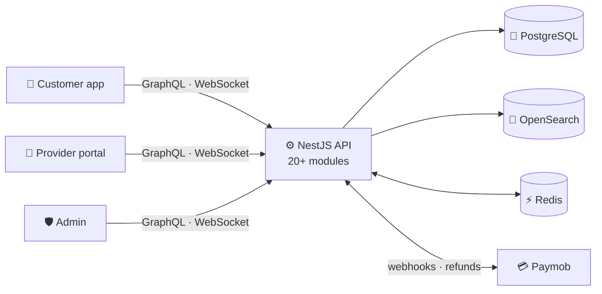
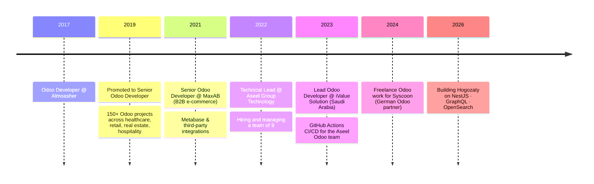

<p align="center">
  <a href="https://github.com/Salem4dev">
    
  </a>
</p>

<p align="center">
  <a href="https://www.linkedin.com/in/salem-hassan/"></a>
  <a href="mailto:salem4work@gmail.com"></a>
  
</p>

<p align="center">
  
  
  
  
</p>

---

## 🧑‍💻 About me

```ts
const salem = {
  role:       "Technical Lead · Senior Software Engineer",
  location:   "Cairo, Egypt — open to relocation (Europe & GCC)",
  experience: "9+ years shipping production business systems",

  leadership: ["Hire & manage a team of 9", "Technical interviews", "Code review", "Mentoring"],
  odoo:       { versions: "10 → 19", editions: ["Community", "Enterprise", "Odoo.sh"], projects: "150+" },
  backend:    ["Python", "TypeScript", "NestJS", "GraphQL", "Flask", "Django"],
  data:       ["PostgreSQL", "Redis", "OpenSearch"],
  devops:     ["GitHub Actions CI/CD", "Docker", "Git submodules", "SonarCloud", "CodeQL"],
  ai:         ["Cursor", "Claude", "Gemini", "OpenRouter"],

  integrations: ["ZATCA e-invoicing", "Geidea", "Paymob", "Aramex", "Bosta", "Metabase"],
  currentlyBuilding: "Hogozaty — a multi-sided booking marketplace on NestJS",
};
```

---

## 🛠️ Tech stack

<p align="center">
  
  <br/>
  
</p>

<p align="center">
  
  
  
  
  
</p>

**🤖 AI-assisted development**

<p align="center">
  
  
  
  
</p>

---

## 🚀 Featured project — [Hogozaty](https://github.com/Salem4dev/hogozaty-showcase)

A multi-sided **service booking marketplace**: customers discover nearby stores and book time slots, providers manage stores and offers, admins run the platform.



| | Highlight |
| --- | --- |
| 🔒 | **Zero double bookings**, enforced by a PostgreSQL exclusion constraint (`tstzrange` + GiST) |
| 🛡️ | **JWT + Passport** for 3 actor types, **CASL** role-based authorization |
| 💳 | **Pluggable payment gateways** with HMAC-verified webhooks, refunds, PDF invoices |
| 🌍 | **Bilingual (AR/EN) geo search** on OpenSearch with event-driven index sync |
| ⚡ | **Real-time notifications** via GraphQL subscriptions over Redis pub/sub |
| 🧪 | DataLoader batching, rate limiting, Helmet, health checks, 36 migrations, Jest, CI |

---

## ⚙️ CI/CD I've built

| Pipeline | What it does |
| --- | --- |
| **Odoo Module CI** | Detects changed modules on every PR, runs Python / XML / JS linting |
| **Security scanning** | CodeQL analysis, TruffleHog secret detection, dependency review, weekly scheduled scans |
| **Quality gates** | SonarCloud quality gate + Codecov coverage on every push |
| **AI code review** | Automated PR review with Odoo-specific checks and semantic PR titles |
| **Build & ship** | Typecheck, build, and push Docker images with Buildx |
| **Repo orchestration** | Git submodules with automated sync to parent repositories |

---

## 🧩 Integrations delivered in production

<p align="center">
  
  
  
  
  
  
</p>

---

## 🗺️ Career journey



---

<p align="center">
  <picture>
    <source media="(prefers-color-scheme: dark)" srcset="https://raw.githubusercontent.com/Salem4dev/Salem4dev/output/github-snake-dark.svg"/>
    
  </picture>
</p>

<p align="center"><i>Most of my client work lives in private repositories. Happy to walk through code in an interview.</i></p>


